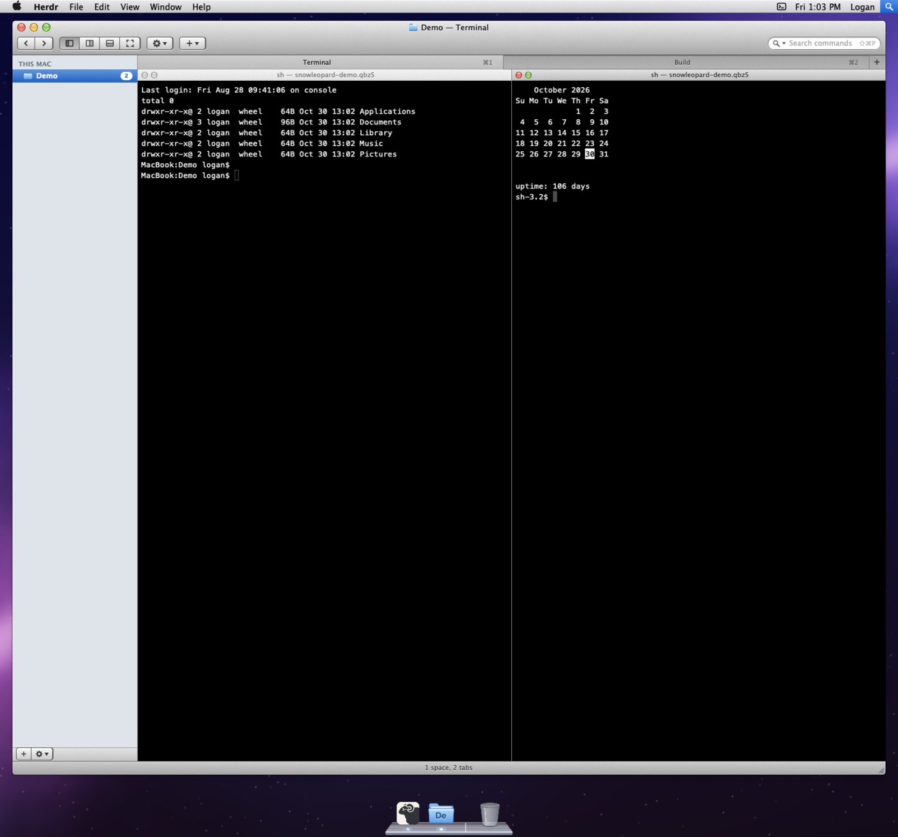
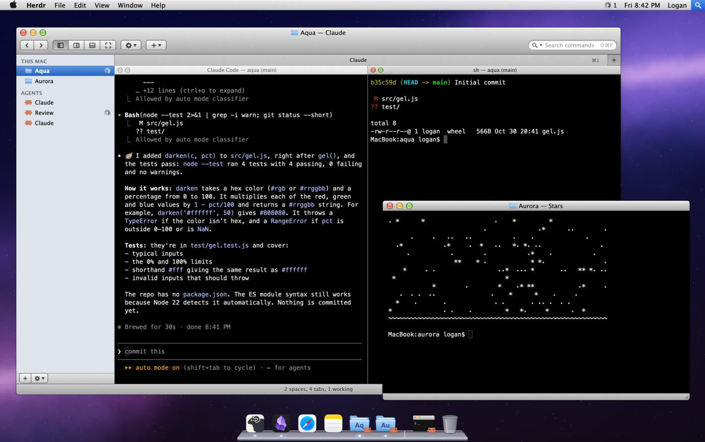

# Snow Leopard for Herdr

Mac OS X 10.6 for the [Herdr](https://herdr.dev) app. It has the menu bar over
the Aurora wallpaper, Aqua windows with unified toolbars, Finder's source list,
Terminal.app tabs and split panes, and Leopard's glass Dock. Every menu, button
and Dock icon runs a real Herdr command.

> **Beta.** Expect rough edges. Please open an issue for anything that looks or
> behaves wrong.



## Features

- **Menu bar.** It has the Apple, Herdr, File, Edit, View, Window and Help
  menus. Their shortcuts are read live from your `keys.json`, and ← → move
  between open menus. On the right are:
  - an agents menu, with a red count when an agent needs you, sorted into
    Needs You, Done, Working and Idle, and "Go to Next Agent That Needs You"
    at the top;
  - a usage meter: how much of your Claude and Codex plan limits is left, as
    a small gauge per service, with what's left of the 5-hour and weekly limits and their
    reset times in its menu (see below);
  - a machines status icon, the clock, a layout switcher and Spotlight (the
    command palette).
- **A real window on the desktop.**
  - Drag its title bar (or bottom bar) to move it and the bottom-right grip to
    resize it. Green, or a double-click on the title, zooms it to fill the
    desktop and back.
  - Glossy traffic lights: red closes and yellow minimizes the Herdr window;
    green zooms the Aqua window.
  - The toolbar has tab navigation, split and zoom controls, an action menu, a
    New menu that can start any installed agent, and a command search field.
- **More windows.** Drag a tab down out of the tab bar (or choose Move Tab to
  New Window) to give it its own window, with its terminals live inside. Red
  closes it (the tab ends, after an alert), yellow minimizes it into the Dock,
  green zooms it, and the bottom-right grip resizes it. Drag its title onto the
  main window's title or tab bar to put the tab back (or right-click the title,
  or use Window › Merge All Windows).
- **Notes (beta).** With Obsidian in the Dock, its icon opens your vault in an
  Aqua window inside Herdr. The vault's folders and notes are in a source list,
  notes render as Markdown, `[[wiki-links]]` open notes in place, and search
  matches names and text. + (⌘N) makes a new note in the shown note's folder; Edit (⌘E) changes the note, with a Markdown | Text | Preview switch: Text edits in the page's font with the Markdown marks faded, and Preview (⇧⌘E) shows the edit formatted before saving; ⌘S or Done saves it, and
  a note changed on disk in the meantime is never overwritten. Notes written
  elsewhere (an agent, a git pull) show up within a few seconds while the window
  is open, and Refresh (⌘R) pulls a git vault (as Obsidian Git's Pull does) and
  rereads it at once. Obsidian itself stays one right-click away.
- **Slack (beta).** With Slack in the Dock, its icon opens Slack as a tab in
  the main window (or, from its right-click menu, in its own Aqua window): channels and DMs, messages with names and threads, and a
  field to send. It uses a small Slack app of your own (the window's setup
  panel creates it) and keeps the token in your Keychain. Unread
  conversations get a count in Slack's list, the Dock's Slack icon a red
  badge for direct messages and mentions, and a new one a banner (click it to
  open the conversation), even with Slack closed. Messages scroll with an
  Aqua scrollbar and open at the newest. It polls (every 5 s for the open
  conversation, 10 s for the watch), so there are no huddles or file uploads.
  Use your User OAuth Token (`xoxp-`): a bot token shows the bot's
  conversations, not yours.
- **Linear (beta).** Linear sits in the Dock as an app of its own (no Linear
  app needed; its icon is fetched from linear.app the first time; Remove from Dock and Dock Applications… take it out and put it
  back). Its icon, or Window › Linear, opens Linear as a tab, or from its
  right-click menu in its own Aqua window, laid out as Mail is:
  Inbox, My Issues, each team and each active project in a source list, the
  issues in a table above, and the selected one below with its
  description, comments and a field to reply. Its status, priority and
  assignee pop up menus to change them.
  - **Open, Closed or All.** The toolbar switch (or a source's right-click
    menu) shows the open issues, the done and canceled ones (newest first,
    grayed), or both; the Inbox switches between All and Unread.
  - **Right-click menus.** A notification: Open in Linear, Mark as Read or
    Unread, Archive, Copy its ID or link, Mark All as Read. An issue: Open in
    Linear, Copy its ID, link or git branch name, Assign to Me, and its
    status and priority. The Inbox in the source list: Mark All as Read and
    Archive All Read.
  - **Search and sort.** Typing in the search field (⌘F) narrows the list;
    Return searches all of Linear, and Esc goes back. Click a column head to
    sort by it, again to reverse.
  - **Keys.** ↑ ↓ walk the list, ⇧⌘U marks read or unread, ⌫ archives a
    notification, Return moves to the reply field, ⌘O opens in Linear, ⌘R
    checks now, and ⌘Z takes back the last change.
  Opening a notification marks it read, and the Dock's Linear icon shows the
  unread count. It signs in with a personal API key (the setup panel opens
  Linear's settings) kept in your Keychain, and checks every 30 s while it's
  on screen; Sign Out is in the ⚙ menu. Pictures show as links, and new
  issues, labels and cycles are made in Linear itself (Open in Linear).
- **Messages (beta).** Messages joins the Dock once by itself, as Linear
  does (Remove from Dock keeps it out). Its icon (or Window › Messages) opens your iMessage and text conversations in an Aqua window
  inside Herdr, or from its right-click menu as a tab. Conversations sit in a
  list, newest first, with each one's latest message and a blue dot and count
  when it's unread. The open one shows as bubbles: blue for what you sent
  (green for SMS), gray for what you got, with names in groups. Type in the
  field and press Return to send through Messages.
  - **New messages.** The Dock's Messages icon shows a red badge, and each new
    message brings a banner (click it to open the conversation), even with the
    window closed. New messages show up within a second or two.
  - **Right-click menus.** A conversation: Open in Messages, Copy Name, Copy
    Phone Number or Email Address, Mark as Read, Mark All as Read. A message:
    Copy, Open Attachment, Show in Finder.
  - **Search and keys.** The search field (⌘F) finds a conversation by name,
    phone number or email. ↑ ↓ walk the list, Return moves to the field, ⌘O
    opens the conversation in Messages, ⌘R checks now.
  - **Setup.** Nothing is read until you click Read My Messages. Herdr reads
    Messages' own database on this Mac (`~/Library/Messages/chat.db`) and
    names from Contacts, and nothing leaves the Mac. That needs Full Disk
    Access for Herdr, a switch in System Settings › Privacy & Security that
    the setup panel opens for you; quit and reopen Herdr after turning it on.
    The first send asks whether Herdr may control Messages. Stop Reading is in
    the ⚙ menu.
  - **Limits.** Reading here doesn't mark anything read in Messages or on
    your phone (that needs Apple's private API), so Herdr keeps its own read
    marks and its counts can differ from Messages'. There are no tapbacks,
    edits, unsend or typing indicators. Attachments show as links that open
    the file. Only the newest 200 messages of a conversation are shown. Group
    sends can fail in Messages itself; when one does, the text stays in the
    field and the window says so.
- **Dock applications.** View › Dock Applications… keeps any app in the Dock
  beside Herdr, with a light under the running ones. Right-click one to open
  the shown space's folder in it. An app that keeps its icon only in its
  asset catalog (no .icns) gets the icon Finder shows.
- **Source list.** AGENTS sits on top: the ones that need you first (oldest
  first), then done, then working, each with its space and machine under its
  name. APPS comes next: Messages, Slack, Linear and notes open as a tab
  (with its space under its name) or a window, each with its unread count;
  their tabs aren't listed again under their spaces. Spaces follow, grouped
  by machine. A space's triangle lists its tabs;
  hover a tab or an agent for a close button. A spinner means working, a red
  badge means it needs you, and a blue dot means done. It scrolls with an
  Aqua scrollbar.
- **Tabs and panes.** The tab bar works like Terminal.app's, with ⌘ numbers.
  A tab you make by hand (⌘T, + or a double-click on the bar) asks for its
  name; tabs agents or scripts make don't. Double-click a tab to rename it.
  ⌘W closes a plain shell at once and asks first when something is running.
  Tabs that don't fit go into a » menu. Split panes get small title strips.
- **Dock.** Each space is a folder with its initials and its most urgent
  agent's icon, and a red badge counting the agents that need you. When one
  starts needing you, its folder hops three times and a small dark notice
  slides in at the top right (click it to go there). Click Herdr's own icon to
  jump to the next agent that needs you; right-click it for the agents menu.
  Minimized windows wait by the Trash, and the Trash closes a tab or space
  after asking first.
- **Status bar.** "2 need you" and "1 done" are links: each click goes to
  the next one.
- **Settings.** Herdr › Snow Leopard Settings… turns the new-tab name prompt,
  the hops, the notices, the done count on Dock badges, the usage meter, and
  Dock hiding on or off. With hiding on (also Apple › Turn Dock Hiding On) the
  Dock tucks away and slides back up when the pointer reaches the bottom edge;
  it's off by default.
- **Aqua dialogs.** Close confirmations, About Herdr, and Force Quit (end any
  terminal).
- **Full screen.** View › Enter Full Screen (⌃⌘F with the keys below) fills the
  display with the whole desktop: menu bar, windows and Dock.
- **Terminal profiles.** Choose Basic, Pro, Homebrew, Ocean or Novel under
  View › Terminal Profile.



## Install

Copy the folders into your Herdr home, then switch to the layout:

```sh
cp -R layouts mods themes ~/.config/herdr-app/
herdr-app check ~/.config/herdr-app/mods/snowleopard
herdr-app do layout.switch --name snowleopard
```

`ctrl-shift-l` cycles layouts to get back. For the Mac keys, merge
`mods/snowleopard/keys.json` into `~/.config/herdr-app/keys.json`:

```json
"layout:snowleopard": {
  "ctrl-f2": "snowleopard.menus",
  "cmd-alt-escape": "snowleopard.forcequit",
  "cmd-m": "window.minimize",
  "ctrl-cmd-f": "snowleopard.fullscreen",
  "f2": "snowleopard.renametab",
  "shift-f2": "snowleopard.renamespace",
  "cmd-t": "snowleopard.newtab",
  "cmd-w": "snowleopard.closetab"
}
```

The layout needs macOS for Lucida Grande and the Apple menu glyph.

## Usage meter

The meter asks Claude's and Codex's own usage pages every 5 minutes (and
when you open its menu), using the logins their CLIs already keep:
`~/.claude/.credentials.json` or the Keychain's "Claude Code-credentials",
and `~/.codex/auth.json` or Pi's `~/.pi/agent/auth.json`. It asks the
machine running the most agents first, so a remote host where your agents
are logged in works without logging in on the Mac. The tokens never leave
that machine; only the usage numbers come back. Turn it off in Snow Leopard
Settings….

## Claude Code theme and context gauge

`claude-code/` has matching Claude Code themes: **Snow Leopard** (dark, for
the Pro profile) and **Snow Leopard Basic** (light). Copy one into
`~/.claude/themes/` and pick it with `/theme`. The `snowleopard-context`
mod draws an Aqua context gauge on Claude Code's footer, and
`snowleopard-context.py` shows the same gauge beside each agent in the layout:

```
/plugin install snowleopard-context --marketplace attractify-logan/herdr-snowleopard
``` See
[claude-code/README.md](claude-code/README.md).

## Layout

| Path | What it is |
|---|---|
| `layouts/snowleopard.json` | The window layout |
| `mods/snowleopard/` | The mod that draws every part (see its README) |
| `themes/snowleopard*.json` | The five Terminal.app profiles |
| `claude-code/` | The matching Claude Code themes |
| `RECIPE.md` | The brief for rebuilding the layout from scratch |

## License

MIT. See [LICENSE](LICENSE). Herdr's app icon (`mods/snowleopard/img/herdr.png`)
belongs to Herdr. Snow Leopard, Aqua and the Apple logo are Apple's
trademarks. This is a fan-made homage, not affiliated with Apple.
