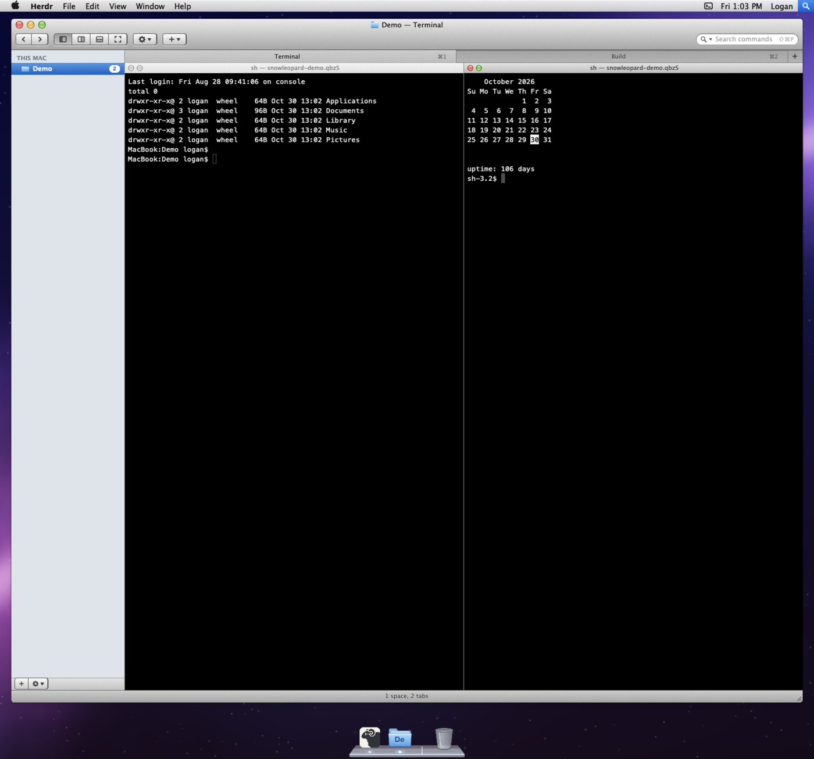

# Snow Leopard

Herdr as Mac OS X 10.6: a translucent menu bar over the Aurora wallpaper,
one Aqua window with a unified title bar and toolbar, Finder's source list
of spaces and agents, Terminal.app's tab bar and split panes, a Finder
status bar, and Leopard's glass Dock, where each space is a folder. Every
menu, button and Dock icon runs a real Herdr command.

## What you see

Top to bottom:

- **Menu bar** (22 px, drags the window). Gradient `#f8f8f8f0` → `#d3d3d3f0`,
  1 px `#7d7d7d` bottom line, Lucida Grande 14. Left: the Apple glyph (U+F8FF),
  bold **Herdr**, File, Edit, View, Window, Help. Right: the agents extra (a
  terminal glyph, or the spoke spinner and a count while agents work, plus a
  pulsing red dot when one is blocked), a Wi-Fi fan for machines (only with
  more than one machine; dimmed if any is unavailable), the clock ("Fri 1:03
  PM"), the user's name, and Spotlight (a blue square, `#4e8de8` → `#1b5fd2`).
- **Desktop**: `mods/snowleopard/img/aurora.jpg` (cover). The window is
  zoomed by default (20 px side and 12 px top/bottom margins) and can be
  placed anywhere on it.
- **Window** (radius 5, `shadow: lg`, 1 px `#00000070` border):
  - **Title bar and toolbar** (58 px, moves the Aqua window on the desktop): `#e9e9e9` → `#a6a6a6`
    when key, `#f7f7f7` → `#d6d6d6` when not, with a `#525252` bottom line.
    Glossy 14 px traffic lights 8 px from the left; a centered title (folder
    proxy icon + "space — tab", embossed). Toolbar: ◀▶ (previous/next tab),
    a 4-segment view control (sidebar, split right, split down, zoom), the
    action gear ▾, New + ▾, and a 190 px rounded search field on the right.
  - **Source list** (210 px, resizable 150–420, `#dee4ea`, or `#e8e8e8` when the
    window isn't key): one heading per machine (THIS MAC, then each machine's
    name, 11 px bold `#646f7c`, embossed, with Hide/Show on hover); 22 px rows
    with a blue folder (gray network folder for remote spaces), the space name,
    and a count pill or agent mark. Then AGENTS: program icon, tab name, status.
    The selected row has a `#5f95d9` → `#2361c1` gradient (graphite when the
    window isn't key). A bottom bar holds + (new space) and the gear ▾.
  - **Tab bar** (24 px): a recessed `#a3a3a3` → `#b4b4b4` strip with equal-width
    tabs; the shown tab is lifted to `#cbcbcb` → `#bdbdbd`. Each tab has its
    agent mark (a flat gray close button on hover), its centered name, and its ⌘ number.
    A + button sits at the end.
  - **Panes**: 1 px `#8b8b8b` gaps. When a tab is split, each pane gets a 19 px
    title strip (small close and zoom beads, "program — folder (branch)",
    status).
  - **Status bar** (23 px, rounded bottom corners): "2 spaces, 4 tabs, 1
    working", plus "1 needs you" in bold dark red; a resize grip on the right.
- **Dock** (92 px block, centered): a 22 px glass trapezoid shelf, 12 px slant,
  with a bright lip and a dark front face. 48 px icons: the Herdr app icon,
  one folder per space (its initials engraved in the folder, its agent's
  icon badged at the bottom right), a dotted zebra separator, and the Trash.

Fonts: Lucida Grande (UI), Menlo 13 (terminals). Terminal profiles under
View › Terminal Profile: Basic (white), Pro (black, the default), Homebrew,
Ocean and Novel, using Terminal.app's ANSI palette.

## How it behaves

- **Agent status** everywhere: *working* is a gray 12-spoke spinner turning
  every 900 ms; *blocked* is a red `!` pill (in the Dock, the space's folder
  bounces 16 px every 760 ms until you're in it, with a red count badge);
  *done* is Mail's blue unread dot (counted in the Dock badge); *idle* shows
  nothing.
- **Menus** open on mouse down and follow the pointer along the menu bar.
  They're translucent white with rounded bottom corners, blue gradient
  selection, checkmarks, gray section headers, and shortcuts read live
  from `keys.json` (⇧⌘D style). Arrow keys, Return, Escape and type-select
  work. Ctrl-F2 walks the menus from the keyboard.
- **Apple menu**: About Herdr, Software Update…, System Preferences…, Dock
  hiding, Force Quit… (pick any terminal and end it; it asks twice), Sleep
  (minimize), Restart… (installs a waiting update), Shut Down… (quits Herdr
  after an Aqua alert; terminals keep running), Log Out (closes the window).
- **File**: new tab or space, New Space in Folder… (folder picker), New Tab
  with Agent (installed agents), splits, close pane/tab/space (tab and space
  ask first), rename, Show in Finder. **Edit**: copy, paste, paste image,
  Find Command (palette). **View**: show or hide the sidebar, tab bar, status
  bar and Dock; Enter/Exit Full Screen (gpui's `window.toggle_fullscreen()`); zoom; terminal profile; layout. **Window**: minimize, zoom,
  next/previous tab and space, zoom pane, Move Tab to New Window, Merge All
  Windows, the space's tabs (checked, ⌘1–9), and the torn-off windows. **Help**: Herdr Help, What's New, Welcome, Send Feedback.
- **Menu extras**: agents (click one to focus it), machines (status, then
  Machines preferences), the clock (the full date), the user (switch
  layout), and Spotlight (the command palette).
- **Traffic lights** go gray when the window isn't key and show ×, − and +
  when hovered. Red closes and yellow minimizes the Herdr window. Green
  zooms the Aqua window to fill the desktop, or puts it back where it was.
- **Moving and resizing**: drag the title bar, the toolbar's bare parts or
  the bottom bar to move the window (clamped to the desktop); drag the
  bottom-right grip to resize it (minimum 520×300). Double-click the title to
  zoom. Dragging a zoomed window un-zooms it to its last size (or 72%×78% of
  the desktop) under the pointer. Placement survives restarts. The menu bar
  moves the Herdr app window itself.
- **More windows**: drag a tab down out of the tab bar, as in Terminal: the
  tab follows the pointer, turns into a ghost window once it's 28 px out of
  the strip, and on release the tab opens as its own Aqua window right there,
  its terminals live inside (released inside the strip, nothing happens). Move
  Tab to New Window (the tab's right-click menu, the Window menu) does the
  same. Drag the title to move it, and the grip in its bottom edge to resize
  it (a blue outline follows the pointer; the window takes the size on
  release, minimum 360×180). Red closes it as a Mac window closes: an alert
  asks, then the tab and its terminals end. Right-click the title for Move Tab
  to Main Window. Yellow minimizes it into the Dock (between the separator and
  the Trash, as a tiny window; click to restore in the same spot), green or a
  double-click on the title zooms it (centered in the app; again goes back
  where it was).
  Window › Merge All Windows brings every tab back and lists the open ones to
  bring forward. Clicking a torn-off agent in the sidebar raises its window.
  The space's last tab stays in the main window. Torn-off windows survive
  restarts. Every window looks key while Herdr is in front (see Watch out).
- **Sidebar**: click a space or agent to go to it; right-click a space (or use
  the bottom gear) for its tabs, Open, New Tab Here, Rename…, Show in Finder
  and Close Space…. Click a heading to fold it.
- **Tabs**: click to select, double-click the strip for a new tab, right-click
  for rename, move left/right and close.
- **Notes**: Obsidian's Dock icon opens the vault (Obsidian's open vault in
  `~/Library/Application Support/obsidian/obsidian.json`) in an Aqua window
  (860×560): a unified title bar and toolbar (◀ ▶ history, Edit/Done, an
  Obsidian button that opens the note in the app, a search field), a 210 px
  source list of folders (disclosure triangles) and notes (a Leopard document
  icon; the open one selected in blue), the note as Markdown on white, and a
  15 px bottom bar with the note count and a resize grip. Front matter is
  hidden; `[[Note]]`, `[[Note|alias]]`, `[[Note#heading]]` and `![[embed]]`
  become links that open the note in place (or an attachment in its app);
  inside code they stay as written. Search matches note names, and their text
  from two letters (`grep -rliF`). Edit (⌘E) swaps in a Markdown editor; ⌘S or
  Done saves with `writeTextFile(path, text, expected)`, so a note changed on
  disk meanwhile isn't overwritten. ⌘[ and ⌘] go back and forward. Red closes
  it, yellow minimizes it beside the Trash, green zooms it. It opens on the
  note read last, else the one changed last. Its Dock menu: Open Vault in
  Herdr, Open Obsidian App.
- **Slack**: Slack's Dock icon opens an app window (`slack.js`, 900×600):
  conversations from `users.conversations` in a 220 px source list (virtual
  list), the open one's last 60 messages from `conversations.history` in a
  measured `list` (Slack mrkdwn turned into Markdown once on arrival: user,
  channel and link tokens, emphasis, a few emoji), "N replies" opening the
  thread (`conversations.replies`), and a message field (`chat.postMessage`,
  into the open thread if any). It polls the open conversation every 5 s and
  the list every 2 minutes. A user token (`xoxp-`) from the person's own Slack
  app (the setup panel opens api.slack.com with a manifest of user scopes, and
  can copy the manifest) is checked with `auth.test` and kept in the Keychain
  (`security`, service `herdr-snowleopard-slack`). Sign Out deletes it.
- **Dock applications**: View › Dock Applications… (or right-click Herdr in
  the Dock) lists every app in /Applications, /System/Applications, their
  Utilities and ~/Applications with its icon and an Aqua checkbox; checked
  ones sit in the Dock right of Herdr. Click one to open it; a light shows
  under the running ones (a process list every 4 s). Right-click: Open, Open
  “space” in the app (the shown space's folder; Obsidian opens it as a vault
  with `obsidian://open?path=`), Show in Finder, Remove from Dock.
- **Dock**: hover shows a dark name pill; clicking Herdr opens the space
  picker; clicking a space opens it; right-click lists its tabs and actions;
  clicking the Trash offers Close Tab or Close Space (each asks first).
- **Alerts**: Aqua gel buttons; the default button is blue and pulses
  (opacity loop, 1700 ms). Return confirms and Escape cancels.

## Built from

- `layouts/snowleopard.json`: a root column (`titlebar: none`,
  `traffic_lights: [-200, -200]` to push macOS's own buttons off the window,
  `theme: snowleopard-pro`, Menlo 13, Lucida Grande, aurora background)
  containing: `menubar` block → `desktop` column (not resizable) [`desk-top`
  block, `desk-row` row [`desk-left` block, `window` column, `desk-right`
  block], `desk-bottom` block]. The desk blocks are the mod's `desk` role
  (transparent; they report their sizes). `window` is a column [`titlebar` block, `body` row [`sidebar` block, `content` column
  [`tabs` block, `main` block `{tab: "active"}` with pane gap 1 and a
  `snowleopard` header `{role: "pane"}` (19 px, top, always, `lone: false`)]],
  `statusbar` block] → `dock` block (92 px). Zoomed, `window` and `desk-row`
  have weight 1 and the desk blocks are margins; placed, `window` and
  `desk-row` have px sizes, `desk-left`/`desk-top` hold the position, and
  `desk-right`/`desk-bottom` take weight 1. Everything goes through
  `layout.resize`.
- `mods/snowleopard/`: one mod, `props.role` picks the part: `menubar`,
  `titlebar`, `sidebar`, `tabs`, `pane`, `status`, `dock`, plus overlays
  `menu` (popup, `frame: "none"`) and `sheet` (dialog: confirm, closetab,
  closespace, about, forcequit), `desk`, `aqua` (a torn-off window's title
  bar), and `drag` (a full-window
  `kind: "window"` overlay opened on a title or grip press that receives
  every pointer move and, once a frame, resizes the spacers that changed until mouse up, or tears a
  pressed tab off once it's pulled 28 px out of the strip). A torn-off tab is
  an overlay window (`kind: "window"`, `frame: "none"`, `key: "sl-win-<tab>"`,
  `keep: true`; `sl-win-<tab>-big` when zoomed) holding a layout: the `aqua`
  title bar block over its terminals' `{terminal}` blocks; the tab is
  `tab.settle`d while it's out and `tab.unsettle`d when it comes back. Shared
  `sl.windows` tracks them (`min`, `big`, `at`, `w`, `h`). The notes window
  is the `notes` role in an overlay window (`key: "sl-notes"`, or
  `"sl-notes-big"` zoomed, `keep: true`; props `vault` and `start` can pick
  another folder and note); shared `sl.notes` holds `open`, `min`, `big`,
  `at`, `w`, `h` and `last`. The window's
  layout is the `aqua` title bar, the terminals, and an `aqua` bottom bar
  (`part: "bar"`, 15 px) with the grip; the grip opens the `drag` overlay in
  `tornresize` mode and the window is reopened by its key at the new size.
  Dock applications live in shared `sl.dockApps` (`path`, `name`, `icon`);
  their icons are made once from each bundle's `CFBundleIconFile` .icns with
  `sips -Z 128` into `mods/snowleopard/.icons/` (hidden, so writing them
  doesn't reload the mod). `kit.js` draws Aqua: px `PathBuilder` rounded
  rects and ovals painted with `window.paint_path` and linear gradients
  (GPUI doesn't clip gradients to rounded boxes, so parts measure themselves
  with `on_size_change`), glass beads, textured segmented buttons, gel buttons,
  count badges, and the shortcut formatter.
- Herdr API used: `spaces`, `agents`, `panes`, `machines`, `focused`, `layout`,
  `layouts`, `keys`, `settings`, `updates`, `knownAgents`, `pickFolder`, `exec`
  (`open` for Show in Finder), `openOverlay`/`closeOverlay`, `shared`/`setShared`
  (`sl.menu`, the open menu), `setAgentOrder`, `nextCommand`, `window()`.
  Commands: `space.*`, `tab.*`, `pane.*`, `terminal.copy/paste/paste_image/kill`,
  `agent.*`, `layout.switch/toggle/set`, `mod.open` (picker), `app.*`,
  `window.*`.
- Themes: `themes/snowleopard.json` (Basic), `-pro`, `-homebrew`, `-ocean`,
  `-novel`: Terminal.app's ANSI palette and Aqua colors for Herdr's own
  panels (accent `#3875d7`).
- Art: `img/aurora.jpg` from `art/aurora.py` (numpy + Pillow); `img/herdr.png`
  (Herdr's app icon); hand-drawn SVGs in `icons/` (full-color folder, network
  folder, Terminal and Trash; one-color glyphs tinted with `svg()`).
- Optional keys (`keys.json`, section `layout:snowleopard`):
  `"ctrl-f2": "snowleopard.menus"`, `"cmd-alt-escape": "snowleopard.forcequit"`,
  `"cmd-m": "window.minimize"`, `"ctrl-cmd-f": "snowleopard.fullscreen"`,
  `"f2": "snowleopard.renametab"`, `"shift-f2": "snowleopard.renamespace"`. Mod commands: `snowleopard.apple|app|file|edit|view|window|help|menus|about|forcequit|fullscreen|tearoff|mergeall|notes|slack|renametab|renamespace`.

## Watch out

- `traffic_lights: [-200, -200]` relies on macOS placing the system buttons
  outside the window. If a Herdr version clamps it, you'll see both sets;
  move them back with `[x, y]` and drop the drawn ones.
- Menu widths are estimated from character counts (7.3 px per character),
  and right-side menus are right-aligned under their extra by the same
  estimate.
- Menus close on an outside press before the title's own press arrives;
  `sl.menu` records `closed`/`at` so a press on the same title within 250 ms
  doesn't reopen it.
- Mouse-down bounds are window coordinates; `openOverlay({at})` takes them
  as is (correct at zoom 1).
- `toLocaleDateString` options are ignored in this runtime; the clock builds
  its day and month names by hand.
- Lucida Grande ships with macOS; elsewhere the UI falls back to the default
  font, and the Apple glyph doesn't render.
- Picking a terminal profile writes the layout root's `theme` with `layout.set`.
- `layout()` doesn't reflect `layout.resize` clicks (they live in
  `layouts/.state/`), so the window's placement is tracked in shared
  `sl.placed` instead of being read back from the layout.
- Overlay windows can't be resized by Herdr, so a torn window's new size is
  applied by reopening it (same key, in place) on release, with an outline
  while dragging; reopening on every frame would be too heavy.
- Apps that ship no .icns (only an asset catalog) get a plain tile with their
  initial. `qlmanage -t` hangs from a mod's `exec`, so it isn't used.
- Render time is budgeted (about 200 ms per redraw) and string work is far
  slower in Herdr's JavaScript than in Node: `localeCompare` with options, a
  per-character `startsWith` scan, or a backtracking regex over a 10 KB note
  each ran a redraw out of time. An interrupted script can leave every part of
  the mod failing to redraw ("Null") until Herdr restarts, so keep redraws
  cheap: the notes window converts a note once when it loads, indexes the
  vault once, compares names with plain lowercase `<`, and draws its source
  list with `v_virtual_list` (only the visible rows).
- Herdr's own prompt dialog (rename) draws its field in the theme's
  `background`, the terminal's: black on black with the Pro profile. Every
  rename here opens the Aqua `rename` sheet instead, and the layout's keys send
  F2 and ⇧F2 to it.
- Herdr can't resize or zoom an overlay window in place, so the app windows
  reopen, and a reopened window is a fresh copy of the mod. Their data lives on
  `globalThis` (module-level state didn't survive), so a new copy shows the
  same note or conversation at once instead of reloading.
- Overlay windows always sit above the layout, so the main Aqua window can't
  be brought in front of one; minimize the window to get it out of the way.
- A shared write redraws every part of the layout at once, so the notes window
  remembers the last note read only when it closes.
- `.when(cond, ...)` needs a real boolean: `undefined` reaches the native side
  as an error that has no stack trace.
- `fs/promises` writes are refused outside a manifest's write roots; Herdr's
  `writeTextFile` works.
- Herdr's `focused()` reports layout terminal blocks but not terminal blocks
  inside overlay windows, so a mod can't tell which Aqua window has the
  keyboard. Every window looks key while Herdr is in front, rather than the
  typed-in one looking inactive. `pane.focus {terminal}` on a torn-off tab's
  terminal focuses its model pane instead: it selects and unsettles the tab,
  so the mod never calls it for torn-off tabs.
- Reopening an overlay window by its key keeps its old spot whatever `at`
  says, and Herdr remembers a spot only after a drag. Torn windows keep their
  own `at` in `sl.windows` (noted on any press on the title or lights, since
  Herdr keeps the release of a window drag), and the zoomed window has its own
  key (`sl-win-<tab>-big`) so it can open centered.
- While Herdr starts or quits, `spaces()` is briefly empty. A kept window that
  closed itself then would drop out of `windows.json`'s kept list, so a torn
  window closes itself only when its tab is put back.
- Every `layout.resize` is a layout pass and every `setShared` redraws every
  part of the layout. Applying a drag on each pointer event (six resizes,
  plus the spacers reporting their sizes) let events queue up on a busy
  window. The drag overlay only notes the wanted frame on each move; a 16 ms
  `cx.timer` applies the latest one, resizing only the nodes that changed
  (one per axis), and `sl.placed` is written once at the end. While
  `sl.dragging` is set, the desk spacers and title bar hold their size
  reports and send them when it clears (the overlay's `close()` clears it,
  however the drag ends).
- An element's `on_mouse_move` only fires while the pointer is over it, so
  dragging uses the full-window `drag` overlay; the title bar alone would
  lose the pointer on a fast move.

## Done when

- `herdr-app check mods/snowleopard` passes, and `layout.switch {name:
  "snowleopard"}` shows no errors in `herdr-app status`.
- Pressing a menu title opens its menu under it; moving along the bar switches
  menus; View lists Terminal Profile and Layout with the current ones checked.
- With an agent working, the sidebar, tab, Dock light and menu extra all show
  the spinner or count. A blocked agent bounces its space's Dock folder and
  adds a red badge.
- Red and yellow close and minimize the real window; green zooms the Aqua
  window to fill the desktop and back. With Herdr in the background the lights
  are gray and the selections turn graphite.
- Dragging the title bar moves the window and the grip resizes it, both
  staying on the desktop; the placement is kept after a restart.
- `snowleopard.tearoff` moves the shown tab to its own window (gone from the
  tab bar, `settled`); yellow puts it in the Dock and clicking it there brings
  it back; `snowleopard.mergeall` puts every tab back, unsettled.
- File › Close Tab opens an Aqua alert, and only Close ends the tab.
- `herdr-app do snowleopard.about` shows About Herdr with the app and core
  versions.
